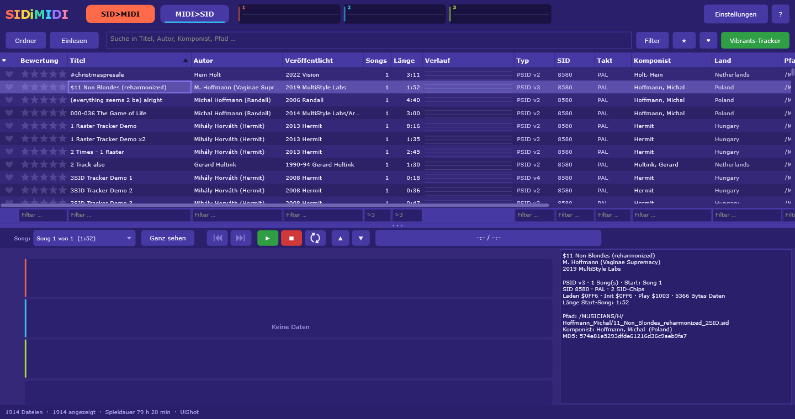
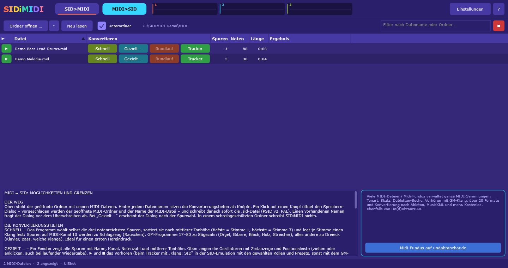
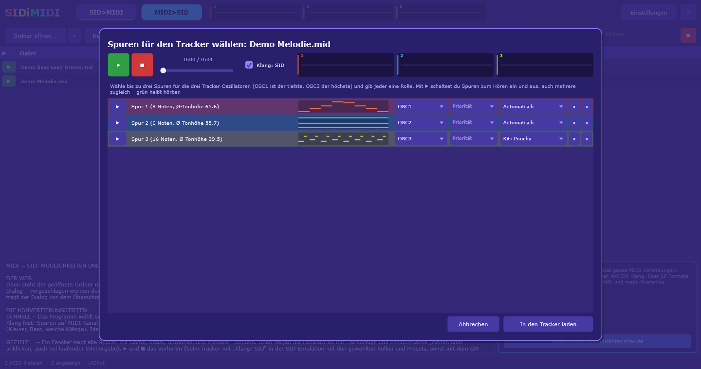
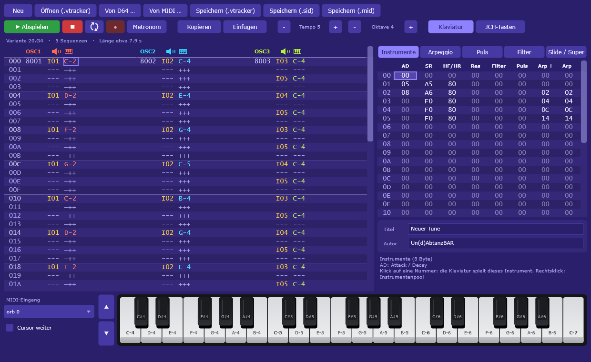

# SIDiMIDI 2.0

**C64-SID-Musik verwalten, anhören, in MIDI verwandeln – und MIDI wieder in SID-Musik. Mit eingebautem Tracker.**
*Manage and play C64 SID music, turn it into MIDI – and MIDI back into SID music. With a built-in tracker.*

Von / by **Un(d)AbtanzBAR** · [undabtanzbar.de/software/sidimidi](https://www.undabtanzbar.de/software/sidimidi/) · Windows 10/11 (64 Bit) · Deutsch · English · Français



## Download

Den Installer gibt es unter **[Releases](https://github.com/Yakobo1970/SIDIMIDI/releases/latest)** (`SIDiMIDI_Setup_v2.0.1.exe`).
*Get the installer from **[Releases](https://github.com/Yakobo1970/SIDIMIDI/releases/latest)**.*
Eine Installation von 1.0 wird aktualisiert (gleiche AppId). Das Programm meldet neue Versionen selbst (einmal am Tag, abschaltbar).

## Was SIDiMIDI kann

### SID > MIDI – die SID-Sammlung
- **Datenbank** über beliebig viele Ordner, auch die [HVSC](https://hvsc.c64.org/) (Autor, Titel, Songs, Länge, Komponisten-Daten); ein eigener Updater spielt die HVSC-Updates (7z) direkt ein.
- **Tabelle** mit Suche und Spaltenfiltern, Bewertung (Sterne), Favoriten, Direktbearbeitung von Titel/Autor/Jahr (schreibt in den SID-Kopf, mit Sicherung und Rückgängig).
- **Player** mit Emulation von 6581/8580: Play/Pause/Stop, Wiederholen, Songs und Tunes durchschalten, Positionsleiste, drei Oszilloskope (OSC1–3) und die **„Verlauf“-Landschaft** der drei Oszillatoren.
- **SID → MIDI**: eine MIDI-Datei mit mehreren Detailstufen.

### MIDI > SID – MIDI in C64-Musik verwandeln


Vier Konvertierungstiefen: **Schnell** (automatisch), **Gezielt** (Spuren, OSC und Rollen selbst wählen), **Rundlauf** (für von SIDiMIDI erzeugte MIDIs) und **Tracker**.



Die **Spurwahl** zeigt je Spur ein Notenbild über die ganze Länge, spielt die Spuren einzeln oder gemeinsam vor (beim Tracker mit der SID-Emulation und dem Klang der gewählten Presets) und bietet:
- **mehrere Spuren auf einem OSC** mit Priorität: wo sie zusammen klingen, gewinnt die höhere, die anderen füllen die Pausen;
- **Rolle** (Lead, Bass, Pad, Schlagzeug) oder direkt ein **Preset** aus dem Instrumentenpool oder ein **Drum-Kit**; `<` / `>` schalten sie schnell durch, auch während des Vorhörens;
- **Drum-Erkennung** über Kanal 10, Spurname und Notenbild; eine Positionsleiste zum Setzen der Vorhör-Zeit.

### Vibrants-Tracker


Ein Tracker für die Tunes des **NewPlayer** von Jens-Christian Huus (JCH, Vibrants), mit eigenem Dateiformat `.vtracker` und Export als `.sid` oder MIDI:
- Raster mit drei OSC-Spuren, Sequenzen sowie Instrumenten-, Arpeggio-, Puls-, Filter- und Super-Tabellen; Undo/Redo;
- Werte per Maus ziehen, Bereiche mit Umschalt markieren, Kopieren/Einfügen, Transponieren, Taktlinien, Metronom;
- Abspielen des Tunes oder nur des markierten Bereichs, mit Wiederholen; Stummschalten und **Sperren** je OSC;
- **Klaviatur** im Stil des M-VAVE FM-1 (Maus oder MIDI-Keyboard) und **Aufnahme-Knopf**;
- Notennamen tippen (C D E F G A H, `#`, `b`, Oktavziffer, Return) oder die **JCH-Tastenbelegung** (Q2W3ER5T6Y7U …);
- **Instrumentenpool** (Rechtsklick auf die Instrumentennummer): 98 Werkspresets (Leads, Bässe, Arpeggios, Pads, Kicks, Snares, Hi-Hats, Effekte), eigene Presets speichern, laden, löschen;
- **MIDI → Tracker** mit Akkord-Arpeggien, Drum-Instrumenten (Kick, Snare, Tom, Becken, Hi-Hat), Puls und Hard-Restart.

## Selbst bauen

Voraussetzungen: Visual Studio 2026 (C++20), CMake ≥ 3.22 und [JUCE 8](https://juce.com/) (Pfad siehe `CMakeLists.txt`).

```
cmake -S . -B build
cmake --build build --config Release --target SIDIMIDI
```

Die App liegt danach unter `build\SIDIMIDI_artefacts\Release\SIDiMIDI.exe`. Der Installer entsteht mit Inno Setup 7: `ISCC.exe Installer\inno-Sidi-setup.iss`.
Hilfswerkzeuge: `SidTest` (Konsole, Tests) und `UiShot` (Screenshots).

## Danksagung

- **Jens-Christian Huus (JCH, Vibrants)** für den NewPlayer und seinen Editor, die Vorlage des Trackers.
- **HVSC – High Voltage SID Collection** und ihre Betreuer für die Sammlung und die Begleitdokumente.
- **JUCE** und **dasm** (mit dem miniplayer für die SID-Konvertierung).
